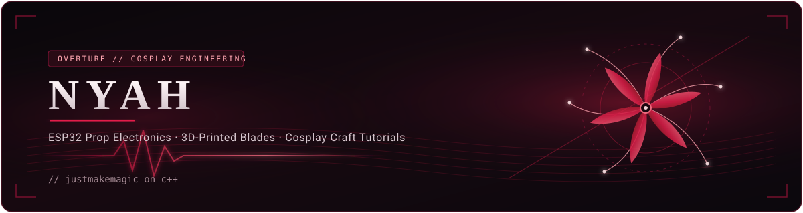
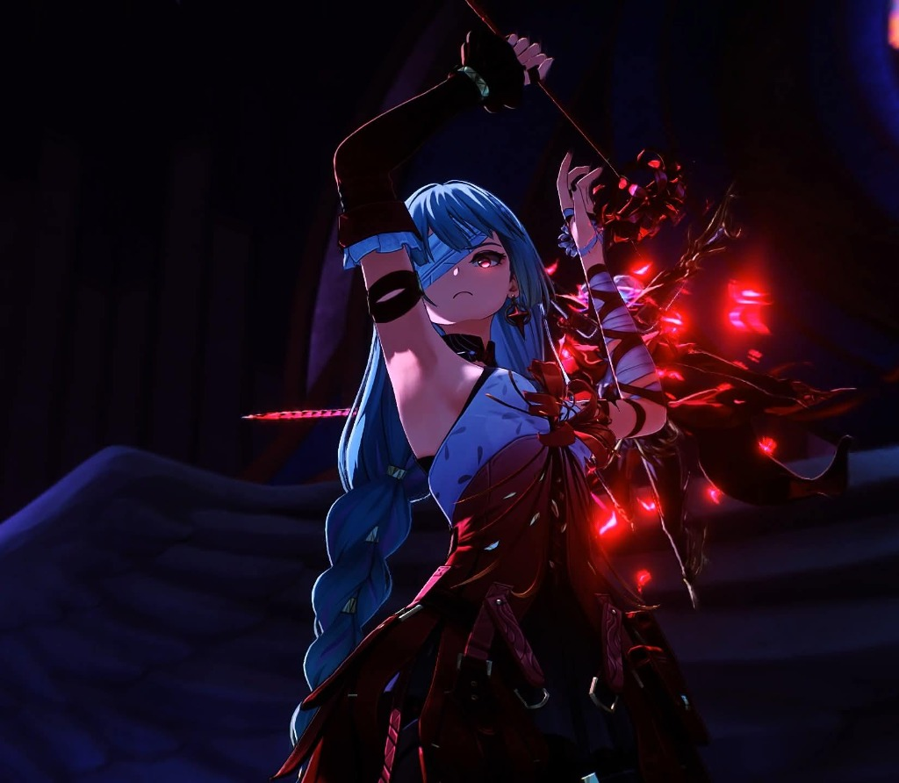
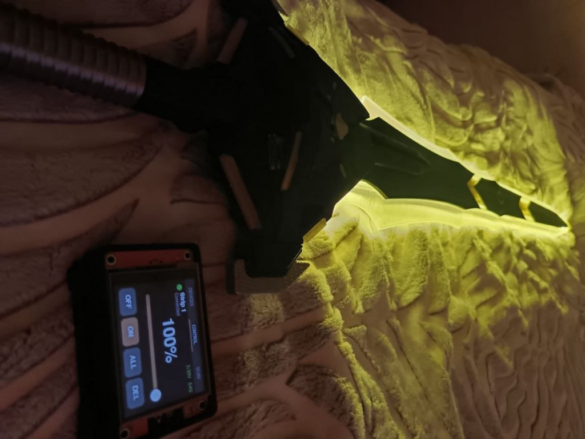
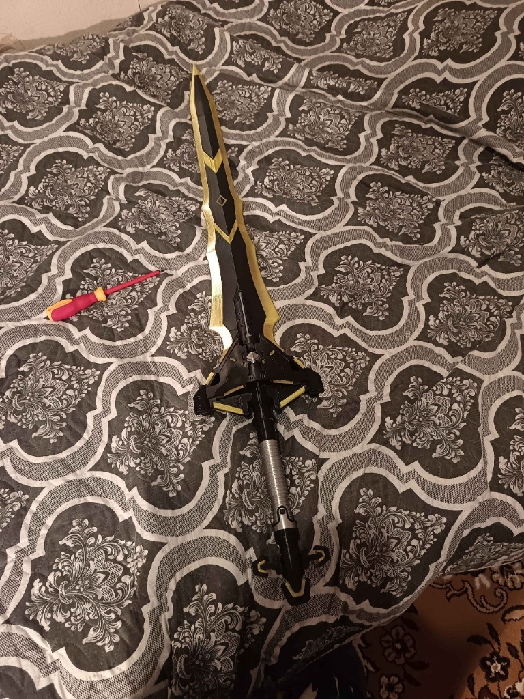
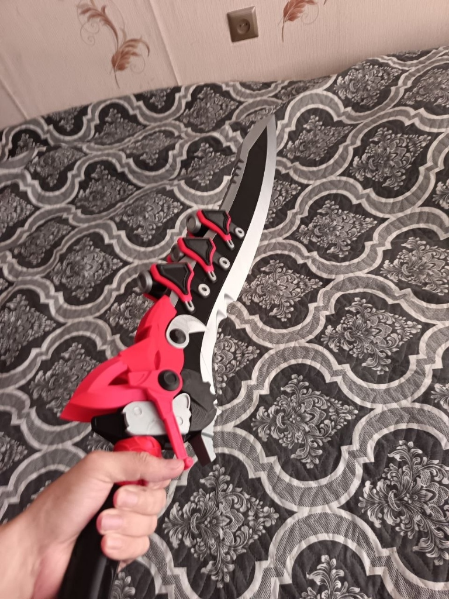
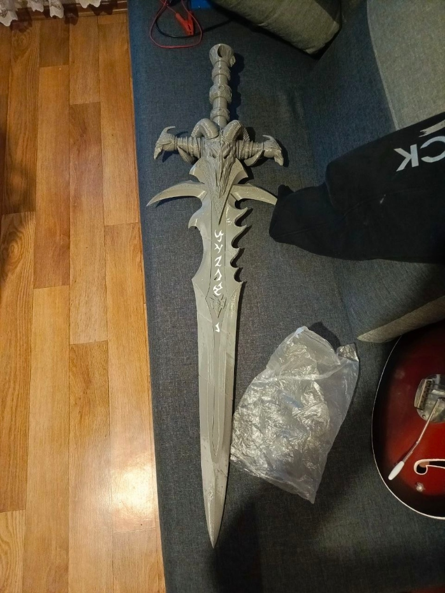
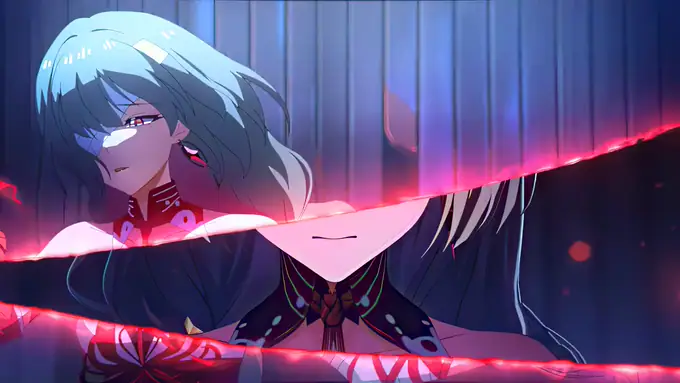

<p align="right">
  <a href="./README.md"></a>
  <a href="./README.ru.md"></a>
</p>

<p align="center">
  
</p>

<p align="center">
  
  
  
  
</p>

<p align="center">
  
</p>

<p align="center">
  
</p>

<p align="center">
  
</p>

### ◆ About

Hey, I'm **Nyah**. I make 3D-printed cosplay weapons and wire them up with ESP32s and LEDs.

I print mostly on a **Bambu Lab** (using **eSUN Transparent PETG** for glowing blade edges and regular PETG for cases) and write my own C++ firmware for the lights. Everything here is stuff I actually built and tested, plus a few guides I wrote down along the way.

- **Done:** Endministrator's Sword (*Arknights: Endfield*, LED + BLE) and Rossi's Sword (*Arknights: Endfield*, simple non-LED print)
- **Working on:** Hoshimi Miyabi's Katana (*ZZZ*) with WS2812B + MPU6500 + Hall sensor in the scabbard, and Frostmourne
- **Control:** all my lit props connect to one ESP32 CYD remote (or just a phone over BLE)
- **Discord:** `c.lappland`

<p align="center">
  
</p>

### ◆ One Remote for Everything

All my LED props use the same BLE UART protocol, so one CYD remote (or any BLE terminal app on a phone) can control all of them:

```text
  [ ESP32 CYD Remote ]  or  [ Phone (BLE) ]
                   │
                   ▼
     ┌─────────────┼─────────────┐
     ▼             ▼             ▼
Endmin's Sword  Miyabi Katana   Next builds
(ESP32-C3 PWM)  (WS2812B+IMU)   (same BLE)
```

<p align="center">
  
</p>

### ◆ Repositories

| Repo | Tech | What's in it |
| :--- | :--- | :--- |
| [**cyd-cosplay-remote**](https://github.com/Nyahhentai/cyd-cosplay-remote) | `ESP32` `ESP32-C3` `BLE` | Firmware for the CYD touchscreen remote (12 FX, up to 3 props) + the ESP32-C3 MOSFET dimmer inside the sword. |
| [**cosplay-craft-tutorials**](https://github.com/Nyahhentai/cosplay-craft-tutorials) | `Electronics` `C++` `3D Print` | Guides on prop soldering/batteries, ESP32/Arduino code, and sanding/painting 3D prints. |
| [**cosplay-prop-builds**](https://github.com/Nyahhentai/cosplay-prop-builds) | `Builds` `Photos` | Photos, wiring notes, and WIP progress for Endmin's Sword, Rossi's Sword, Miyabi's Katana, and Frostmourne. |

<p align="center">
  
</p>

### ◆ Builds

<table>
  <tr>
    <td align="center" width="50%">
      <br/>
      <strong>CYD Remote + Endmin's Sword</strong><br/>
      <sub>Arknights: Endfield · BLE brightness, FX &amp; battery</sub>
    </td>
    <td align="center" width="50%">
      <br/>
      <strong>Endministrator's Sword</strong><br/>
      <sub>Bambu Lab + eSUN Transparent PETG edge</sub>
    </td>
  </tr>
  <tr>
    <td align="center" width="50%">
      <br/>
      <strong>Rossi's Sword</strong><br/>
      <sub>Arknights: Endfield · simple 3D print, no LEDs</sub>
    </td>
    <td align="center" width="50%">
      <br/>
      <strong>Frostmourne (WIP)</strong><br/>
      <sub>World of Warcraft · still working on sanding &amp; paint</sub>
    </td>
  </tr>
</table>

<p align="center">
  
</p>

### ◆ Progress

| Build | From | Progress | Notes |
| :--- | :--- | :---: | :--- |
| **Endministrator's Sword** | *Arknights: Endfield* | `██████████` 100% | ESP32-C3, IRLB8721, eSUN Transparent PETG, CYD BLE |
| **Rossi's Sword** | *Arknights: Endfield* | `██████████` 100% | Bambu Lab multi-part print |
| **Miyabi's Katana (Tailless)** | *Zenless Zone Zero* | `█████░░░░░` 50% | ESP32-C3 (60 FPS), WS2812B 60 LEDs, MPU6500, 49E Hall, 18650 |
| **Frostmourne** | *World of Warcraft* | `██████░░░░` 60% | Printed, finishing seams &amp; paint |

<p align="center">
  
</p>

### ◆ Stuff I Use

<p align="center">
  
  
  
  
  
  
  
</p>

<p align="center">
  
  
</p>

<br/>

<!-- 4E 79 61 68 // c.lappland -->

<details>
  <summary align="center">◆ <em>[ don't click ]</em> ◆</summary>
  <br/>

```cpp
// "Silence says more than code ever could."
class Nyah {
public:
  const char* firstRepo = "just-calc-on-c- (im just start lol)";
  const char* now       = "glowing swords & esp32 stuff";
  const char* discord   = "c.lappland";
};
```

  <p align="center">
    <sub>Where it all started: <a href="https://github.com/Nyahhentai/just-calc-on-c-"><strong>just-calc-on-c-</strong></a> 🧮</sub>
  </p>

  <details>
    <summary align="center"><sub>◆ <em>[ ok fine, one more ]</em> ◆</sub></summary>
    <br/>

```text
times i forgot heat-shrink before soldering : too many
boost converters used in miyabi's katana    : 0
remaining battery after sanding frostmourne : 3.72 V (18%)
FX_TOUCH_GRASS                              : TODO
```

    <p align="center">
      <sub>send <code>0x4E594148</code> in discord <code>c.lappland</code> if you actually read this far</sub>
    </p>
  </details>
</details>

<p align="center">
  
</p>

<p align="center">
  
</p>
