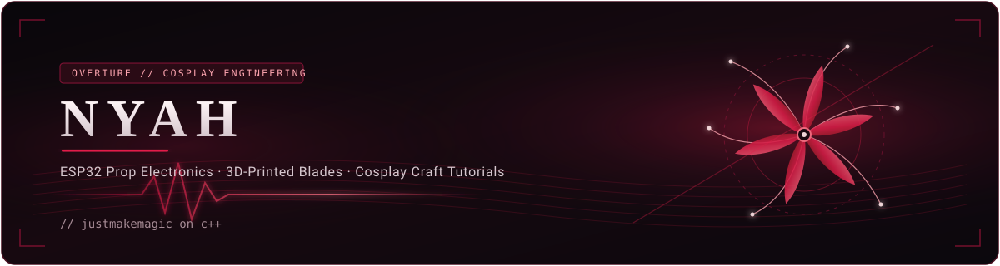
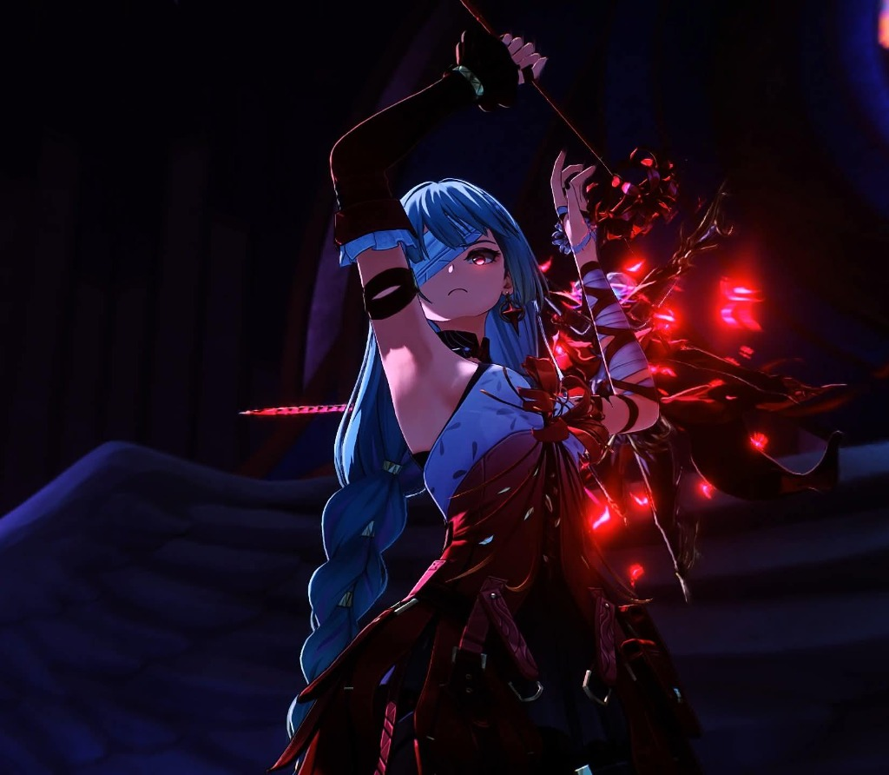
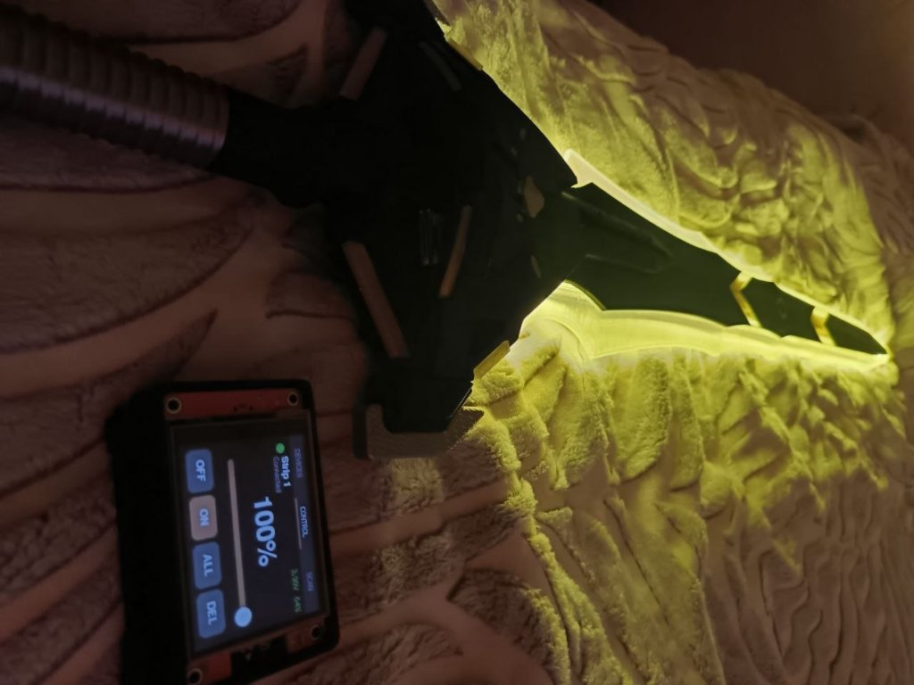
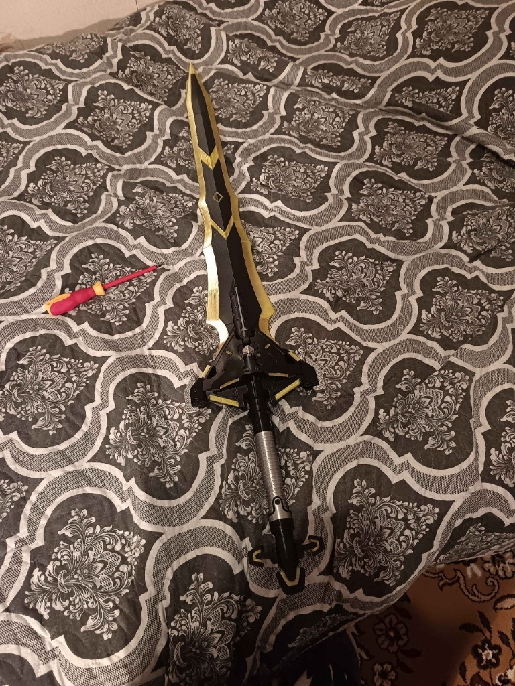
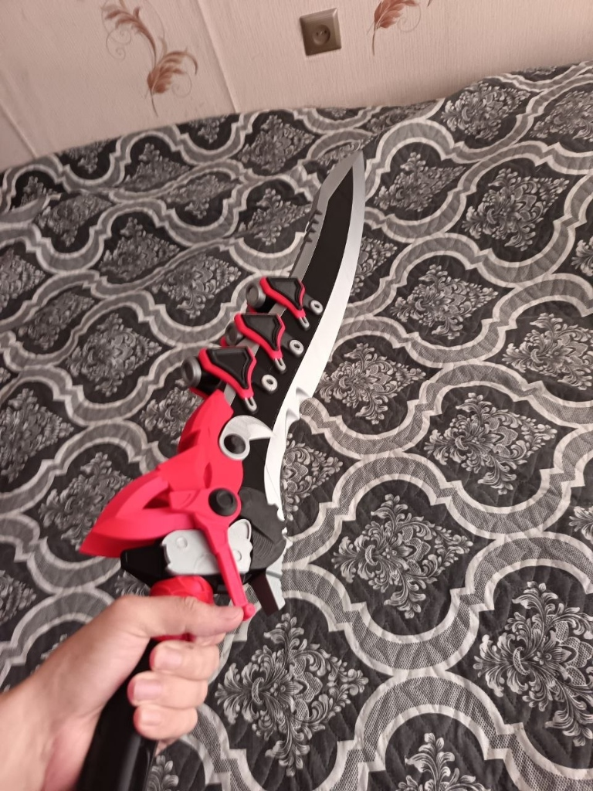
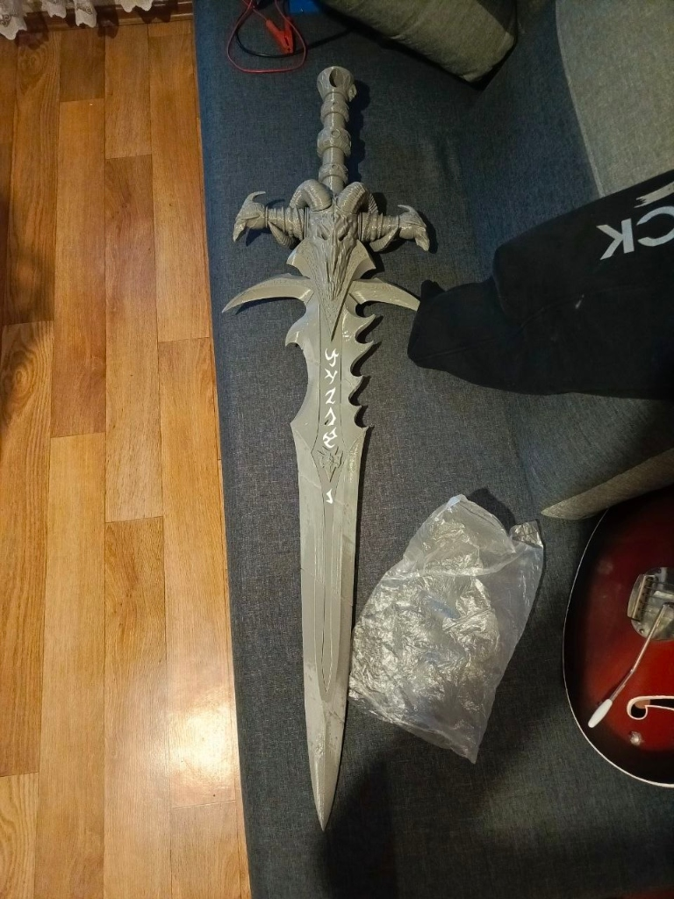
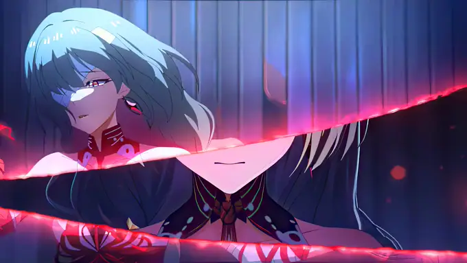

<p align="right">
  <a href="./README.md"></a>
  <a href="./README.ru.md"></a>
</p>

<p align="center">
  
</p>

<p align="center">
  
  
  
  
</p>

<p align="center">
  
</p>

<p align="center">
  
</p>

<p align="center">
  
</p>

### ◆ Обо мне

Привет, я **Nyah**. Делаю 3D-печатное косплей-оружие и запихиваю туда ESP32 со светодиодами.

Печатаю на **Bambu Lab** (прозрачные кромки из **eSUN Transparent PETG**, корпуса из обычного PETG), прошивки пишу сам на C++. Здесь лежат мои реальные самоделки, схемы и пара гайдов по крафту.

- **Готово:** Меч Эндмина (*Arknights: Endfield*, LED + BLE) и Меч Rossi (*Arknights: Endfield*, просто 3D-печать без света)
- **В процессе:** Катана Мияби (*ZZZ*) с WS2812B + MPU6500 + датчик Холла в ножнах, и Фростморн
- **Управление:** всё светящееся работает от одного пульта на ESP32 CYD (плюс можно управлять просто с телефона по BLE)
- **Discord:** `c.lappland`

<p align="center">
  
</p>

### ◆ Один пульт на всё

Все светящиеся мечи сидят на одном протоколе BLE UART, так что один пульт CYD (или обычный BLE-терминал на телефоне) рулит всем сразу:

```text
  [ Пульт ESP32 CYD ]  или  [ Телефон (BLE) ]
                   │
                   ▼
     ┌─────────────┼─────────────┐
     ▼             ▼             ▼
Меч Эндмина   Катана Мияби   Новые проекты
(ESP32-C3)    (WS2812B+IMU)  (тот же BLE)
```

<p align="center">
  
</p>

### ◆ Репозитории

| Репозиторий | Стек | Что внутри |
| :--- | :--- | :--- |
| [**cyd-cosplay-remote**](https://github.com/Nyahhentai/cyd-cosplay-remote) | `ESP32` `ESP32-C3` `BLE` | Прошивка пульта на CYD (12 эффектов, до 3 устройств) + диммер на ESP32-C3 с MOSFET для меча. |
| [**cosplay-craft-tutorials**](https://github.com/Nyahhentai/cosplay-craft-tutorials) | `Электроника` `C++` `3D-печать` | Гайды на английском по пайке/батареям, коду для ESP32/Arduino и постобработке 3D-печати. |
| [**cosplay-prop-builds**](https://github.com/Nyahhentai/cosplay-prop-builds) | `Проекты` `Фото` | Фотки, схемы и прогресс по мечу Эндмина, мечу Rossi, катане Мияби и Фростморну. |

<p align="center">
  
</p>

### ◆ Проекты

<table>
  <tr>
    <td align="center" width="50%">
      <br/>
      <strong>Пульт CYD + Меч Эндмина</strong><br/>
      <sub>Arknights: Endfield · яркость, эффекты и заряд по BLE</sub>
    </td>
    <td align="center" width="50%">
      <br/>
      <strong>Меч Эндмина</strong><br/>
      <sub>Bambu Lab + кромка из eSUN Transparent PETG</sub>
    </td>
  </tr>
  <tr>
    <td align="center" width="50%">
      <br/>
      <strong>Меч Rossi</strong><br/>
      <sub>Arknights: Endfield · простая 3D-печать без LED</sub>
    </td>
    <td align="center" width="50%">
      <br/>
      <strong>Фростморн (WIP)</strong><br/>
      <sub>World of Warcraft · в процессе шлифовки и покраски</sub>
    </td>
  </tr>
</table>

<p align="center">
  
</p>

### ◆ Прогресс

| Проект | Откуда | Прогресс | Заметки |
| :--- | :--- | :---: | :--- |
| **Меч Эндмина** | *Arknights: Endfield* | `██████████` 100% | ESP32-C3, IRLB8721, eSUN Transparent PETG, пульт CYD |
| **Меч Rossi** | *Arknights: Endfield* | `██████████` 100% | Печать на Bambu Lab |
| **Катана Мияби (Tailless)** | *Zenless Zone Zero* | `█████░░░░░` 50% | ESP32-C3 (60 FPS), WS2812B 60 диодов, MPU6500, Холл 49E, 18650 |
| **Фростморн** | *World of Warcraft* | `██████░░░░` 60% | Напечатан, доделываю швы и покраску |

<p align="center">
  
</p>

### ◆ Что использую

<p align="center">
  
  
  
  
  
  
  
</p>

<p align="center">
  
  
</p>

<br/>

<details>
  <summary align="center">◆ <em>[ не нажимай ]</em> ◆</summary>
  <br/>

```cpp
// "Silence says more than code ever could."
class Nyah {
public:
  const char* firstRepo = "just-calc-on-c- (im just start lol)";
  const char* now       = "светящиеся мечи и esp32";
  const char* discord   = "c.lappland";
};
```

  <p align="center">
    <sub>С чего всё началось: <a href="https://github.com/Nyahhentai/just-calc-on-c-"><strong>just-calc-on-c-</strong></a> 🧮</sub>
  </p>

  <details>
    <summary align="center"><sub>◆ <em>[ ладно, ещё один ]</em> ◆</sub></summary>
    <br/>

```text
раз забыл надеть термоусадку до пайки       : слишком много
повышаек в катане мияби                     : 0
заряд рассудка после шлифовки фростморна    : 3.72 V (18%)
FX_TOUCH_GRASS                              : TODO
```

    <p align="center">
      <sub>скинь <code>0x4E594148</code> в дискорд <code>c.lappland</code>, если реально дочитал сюда</sub>
    </p>
  </details>
</details>

<p align="center">
  
</p>

<p align="center">
  
</p>
